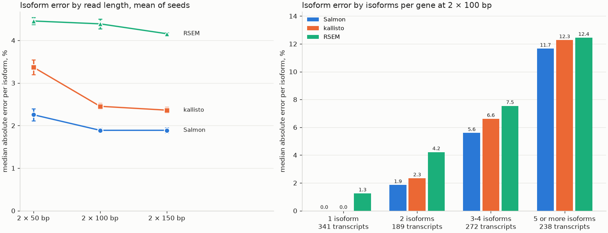

# isoform-quantification-benchmark

On paired-end reads simulated from every protein-coding and lncRNA isoform of chr22, Salmon and kallisto recover isoform counts within 2.5% median error at 2 × 100 bp. The error grows from 2% to 12% as genes carry more isoforms, and featureCounts, accurate on the median gene, misses by more than 10% on a quarter of genes.

Diego G. Salas · GRCh38 chr22 from UCSC, GENCODE release 46 basic annotation · fragments simulated with polyester 1.38.0

## Run it

```bash
micromamba create -n isoform-quantification-benchmark -f environment.yml && micromamba activate isoform-quantification-benchmark
bash run.sh
```

Runs on `tests/data`, one megabase of chr22 in 0.3 MB, in 39 s on 2 threads. `CONFIG=config/config.sh bash run.sh` runs the whole of chr22 with nine samples of 1 000 000 fragments, in 35 min 44 s on 6 threads under WSL. `DRY_RUN=1` prints the commands. `bash tests/make_test_data.sh` rebuilds the test megabase byte for byte.

<table>
<thead><tr><th>Stage</th><th>Script</th><th>Output</th></tr></thead>
<tbody><tr><td>01</td><td><code>workflow/01_download.sh</code></td><td>chr22 and the GENCODE GTF in <code>data/reference/raw</code></td></tr></tbody>
<tbody><tr><td>02</td><td><code>workflow/02_prepare.py</code></td><td>genome, GTF and spliced sequence of every kept transcript, with the share of sequence each isoform owns</td></tr></tbody>
<tbody><tr><td>03</td><td><code>workflow/03_design.py</code></td><td>the ground truth, fragments per transcript, shared by every sample</td></tr></tbody>
<tbody><tr><td>04</td><td><code>workflow/04_simulate.R</code></td><td>paired-end FASTQ per sample, and the truth read back from the read names</td></tr></tbody>
<tbody><tr><td>05</td><td><code>workflow/05_index_align.sh</code></td><td>Salmon, kallisto, STAR and RSEM indexes, STAR alignments to the genome and to the transcriptome</td></tr></tbody>
<tbody><tr><td>06</td><td><code>workflow/06_quantify.sh</code></td><td>isoform counts by Salmon, kallisto and RSEM, gene counts by featureCounts</td></tr></tbody>
<tbody><tr><td>07</td><td><code>workflow/07_benchmark.py</code></td><td>error of every method against the truth per isoform and per gene, tables and figure</td></tr></tbody>
</table>

## Design

Each sample holds 1 000 000 paired-end fragments from the 1 941 transcripts of 861 protein-coding and lncRNA genes that lie on chr22 and are 400 bp or longer. A fixed seed expresses 677 of the genes with log-normal weights and splits each gene between its isoforms in Dirichlet proportions with concentration 0.5, so 1 421 transcripts carry fragments and one isoform often dominates its gene. Fragments average 250 bp with a standard deviation of 25 bp and are read as 2 × 50, 2 × 100 or 2 × 150 bp with a uniform error rate of 0.5%. Three sample seeds per read length change where fragments fall and which bases carry errors. Error metrics use the 1 040 isoforms and 640 genes with at least 20 true fragments. Each isoform also gets the share of its 31-mers that no other isoform of the same gene contains.

## Main result

At 2 × 100 bp, mean of three seeds. The source is `results/benchmark_summary.tsv`.

<table>
<thead><tr><th>Level</th><th>Method</th><th>Spearman with the truth</th><th>Median absolute error</th><th>Off by more than 10%</th><th>Fragments counted, share of the truth</th></tr></thead>
<tbody><tr><td>isoform</td><td>Salmon</td><td>0.966</td><td>1.9%</td><td>25.3%</td><td>100.0%</td></tr></tbody>
<tbody><tr><td>isoform</td><td>kallisto</td><td>0.973</td><td>2.5%</td><td>27.6%</td><td>99.6%</td></tr></tbody>
<tbody><tr><td>isoform</td><td>RSEM</td><td>0.966</td><td>4.4%</td><td>28.5%</td><td>97.8%</td></tr></tbody>
<tbody><tr><td>gene</td><td>Salmon</td><td>1.000</td><td>0.0%</td><td>1.2%</td><td>100.0%</td></tr></tbody>
<tbody><tr><td>gene</td><td>kallisto</td><td>0.999</td><td>0.0%</td><td>1.5%</td><td>99.6%</td></tr></tbody>
<tbody><tr><td>gene</td><td>RSEM</td><td>0.998</td><td>2.1%</td><td>2.9%</td><td>97.8%</td></tr></tbody>
<tbody><tr><td>gene</td><td>featureCounts</td><td>0.953</td><td>0.2%</td><td>25.0%</td><td>92.7%</td></tr></tbody>
</table>

Isoform error follows how much sequence an isoform shares with its siblings. At 2 × 100 bp Salmon misses by 0.0% on isoforms that own half or more of their 31-mers and by 9.7% on isoforms that own less than a tenth, and the three methods show the same gradient. By number of isoforms, Salmon goes from 1.9% in genes with two to 11.7% in genes with five or more.

At the gene level the median hides a tail. featureCounts lands within 0.2% of the truth on the median gene, yet counts 92.7% of the fragments and misses by more than 10% on 25.0% of genes, because fragments that overlap two genes or align to two places are left out. That share grows with read length, 24.1%, 25.0% and 28.2%, as longer reads overlap more genes. RSEM counts 97.8% of the fragments at every read length. STAR leaves soft-clipped alignments out of the transcriptome BAM it writes for RSEM, 19 439 of 997 386 aligned fragments in one sample at 2 × 100 bp.



*Left, median absolute error per isoform by read length, bars are one standard deviation over three seeds. Right, the same error at 2 × 100 bp by number of isoforms in the gene.*

### Isoform error by sequence sharing

At 2 × 100 bp, median absolute error per isoform, mean of three seeds. The source is `results/benchmark_strata.tsv`.

<table>
<thead><tr><th>Split by</th><th>Stratum</th><th>Isoforms</th><th>Salmon</th><th>kallisto</th><th>RSEM</th></tr></thead>
<tbody><tr><td>isoforms in the gene</td><td>1</td><td>341</td><td>0.0%</td><td>0.0%</td><td>1.3%</td></tr></tbody>
<tbody><tr><td>isoforms in the gene</td><td>2</td><td>189</td><td>1.9%</td><td>2.3%</td><td>4.2%</td></tr></tbody>
<tbody><tr><td>isoforms in the gene</td><td>3-4</td><td>272</td><td>5.6%</td><td>6.6%</td><td>7.5%</td></tr></tbody>
<tbody><tr><td>isoforms in the gene</td><td>5 or more</td><td>238</td><td>11.7%</td><td>12.3%</td><td>12.4%</td></tr></tbody>
<tbody><tr><td>31-mers owned by the isoform</td><td>under 10%</td><td>436</td><td>9.7%</td><td>10.9%</td><td>11.1%</td></tr></tbody>
<tbody><tr><td>31-mers owned by the isoform</td><td>10-50%</td><td>160</td><td>3.5%</td><td>4.3%</td><td>6.2%</td></tr></tbody>
<tbody><tr><td>31-mers owned by the isoform</td><td>50% or more</td><td>444</td><td>0.0%</td><td>0.1%</td><td>1.5%</td></tr></tbody>
</table>

## Confirmed vs not confirmed

<table>
<thead><tr><th>Claim</th><th>Status</th><th>Basis</th></tr></thead>
<tbody><tr><td>Salmon and kallisto stay under 3.5% median isoform error at 2 × 50, 2 × 100 and 2 × 150 bp</td><td>confirmed on simulated chr22, three seeds per read length</td><td><code>results/benchmark_summary.tsv</code>, 2.3%, 1.9% and 1.9% for Salmon, 3.4%, 2.5% and 2.4% for kallisto, seed standard deviation 0.2 points or less</td></tr></tbody>
<tbody><tr><td>Isoform error rises with isoforms per gene and falls with the sequence an isoform owns</td><td>confirmed on simulated chr22 for all three isoform methods</td><td><code>results/benchmark_strata.tsv</code></td></tr></tbody>
<tbody><tr><td>featureCounts misses by more than 10% on about a quarter of genes</td><td>confirmed on simulated chr22, three seeds per read length</td><td>24.1%, 25.0% and 28.2% of genes. Its summary files name ambiguity and multimapping as the reasons fragments go uncounted</td></tr></tbody>
<tbody><tr><td>The RSEM shortfall comes from soft-clipped alignments left out of the transcriptome BAM</td><td>confirmed on one sample</td><td>fragment counts in the genome and transcriptome BAM files of <code>pe100_s1</code></td></tr></tbody>
<tbody><tr><td>STAR in end-to-end mode removes the RSEM shortfall</td><td>not tested</td><td>a rerun with <code>--alignEndsType EndToEnd</code></td></tr></tbody>
<tbody><tr><td>The same ranking holds on the whole genome or on real reads</td><td>not tested</td><td>one chromosome, simulated reads only</td></tr></tbody>
</table>

## Limitations

- Only chr22 is in the index, so no read from a paralog on another chromosome can mislead a method.
- The same annotation is used to simulate and to quantify, so no method pays for missing or wrong isoforms, the main source of error on real data.
- Fragments are spread uniformly along transcripts with uniform errors and no sequence or GC bias, which is why Salmon runs without its bias models here.
- Base qualities are constant, so they carry no information for any method.
- Transcripts shorter than 400 bp are left out.
- A Dirichlet concentration of 0.5 lets one isoform dominate most genes. A flatter split would raise the error on minor isoforms.

## Not done on purpose

- No end-to-end STAR run for RSEM. The defaults are the ones most pipelines use.
- No assembly-based method such as StringTie. This benchmark assumes a known annotation.
- No differential transcript usage, although the same simulation could carry fold changes between conditions.
- No concordance on real reads. That is the natural check against the limits of simulation.
